# Phase 1: DDIC Objects (Custom Tables & Structures)

## Overview

The first step is to create the Data Dictionary (DDIC) objects required for the custom Site master data object. These objects define how the data is stored, processed, and locked within the system. 

**In this implementation, the approved Site records will be stored directly in the custom ERP table `YMDG_SITE`.**

---

## 1.1 Create Domain and Data Element for SITE_ID

### Step 1: Create Domain ZDOM_SITE_ID

1. Open transaction **SE11**
2. Select **Domain**
3. Enter name: `ZDOM_SITE_ID`
4. Click **Create**
5. Configure:
   - **Data Type:** CHAR
   - **Length:** 10
   - **Output Length:** 10

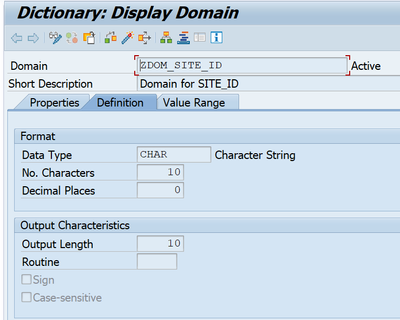

6. **Save** (assign to package or local object)
7. **Activate** the domain

---

### Step 2: Create Data Element ZSITE_ID

1. Open transaction **SE11**
2. Select **Data Type** → **Data Element**
3. Enter name: `ZSITE_ID`
4. Click **Create**
5. Configure:
   - **Domain:** ZDOM_SITE_ID

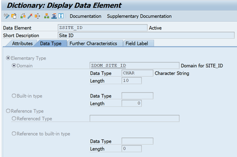

6. Maintain **Field Labels:**

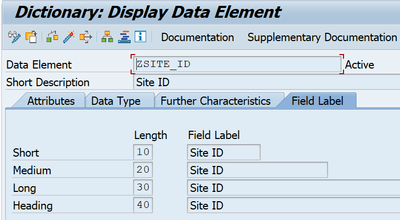

   - **Short:** Site ID
   - **Medium:** Site ID
   - **Long:** Site ID
   - **Heading:** Site ID

7. **Save** and **Activate**

---

## 1.2 Create Main ERP Table YMDG_SITE

### Step 1: Create Table

1. Open transaction **SE11**
2. Select **Database Table**
3. Enter name: `YMDG_SITE`
4. Click **Create**

---

### Step 2: Configure Delivery and Maintenance

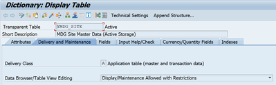

- **Delivery Class:** A (Application table)
- **Data Browser/Table View Maintenance:** Display/Maintenance Allowed with Restrictions

---

### Step 3: Define Table Fields

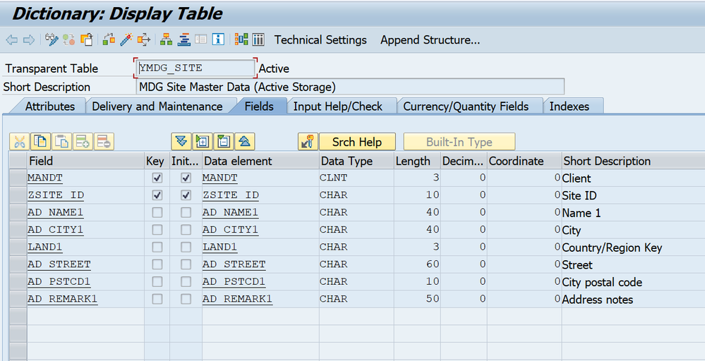

| Field Name | Key | Data Element | Description |
|------------|-----|--------------|-------------|
| MANDT | ✓ | MANDT | Client |
| ZSITE_ID | ✓ | ZSITE_ID | Site ID |
| AD_NAME1 | | AD_NAME1 | Name |
| AD_CITY1 | | AD_CITY1 | City |
| LAND1 | | LAND1 | Country |
| AD_STREET | | AD_STREET | Street |
| AD_PSTCD1 | | AD_PSTCD1 | Postal Code |
| AD_REMARK1 | | AD_SMTPADR | Description |

---

### Step 4: Set Enhancement Category

1. Go to **Extras** → **Enhancement Category**
2. Select: **Can be Enhanced (Deep)**

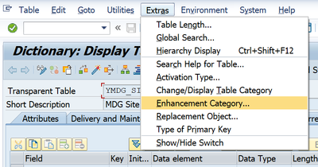

---

### Step 5: Maintain Technical Settings

1. Press **Ctrl+Shift+F9** (or click Technical Settings button)

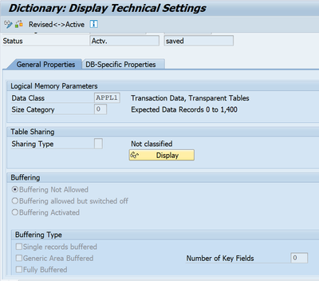

2. Configure:
   - **Data Class:** APPL0 (Master data)
   - **Size Category:** 1 (or as per requirement)

3. **Save** and **Activate** the table

---

## 1.3 Create Supporting Structures

### A. Structure ZMDG_SITE_S

**Purpose:** Main data structure for Site entity

1. Transaction: **SE11**
2. Select **Data Type** → **Structure**
3. Name: `ZMDG_SITE_S`
4. Click **Create**

**Define Fields:**

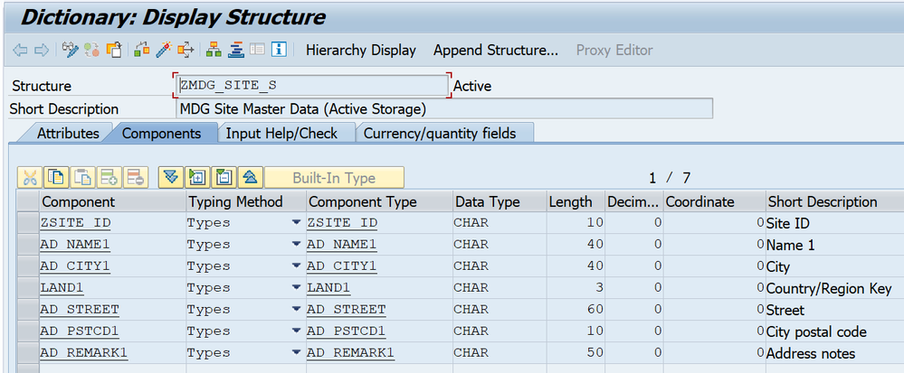

| Field Name | Component Type | Description |
|------------|----------------|-------------|
| SITE | ZSITE_ID | Site ID |
| NAME | AD_NAME1 | Name |
| CITY | AD_CITY1 | City |
| COUNTRY | LAND1 | Country |
| STREET | AD_STREET | Street |
| ZIP | AD_PSTCD1 | Postal Code |
| DESCR | AD_SMTPADR | Description |

**Set Enhancement Category:**

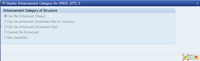

5. **Extras** → **Enhancement Category** → **Can be Enhanced (Deep)**
6. **Save** and **Activate**

---

### B. Structure ZMDG_SITE_S_X

**Purpose:** Change indicator structure (X-structure)

1. Transaction: **SE11**
2. Name: `ZMDG_SITE_S_X`
3. Click **Create**

**Define Fields:**

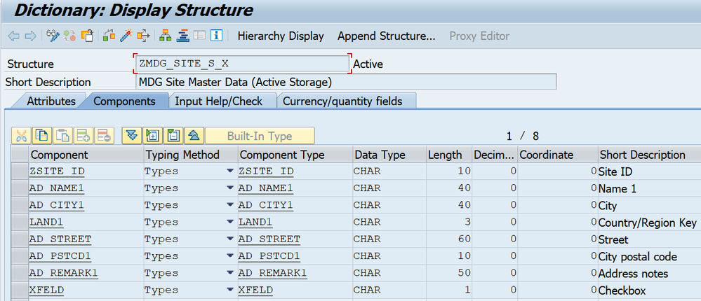

| Field Name | Component Type | Description |
|------------|----------------|-------------|
| ZSITE_ID | ZSITE_ID | Site ID |
| AD_NAME1 | MDG_BS_CHG_INDICATOR | Change Indicator |
| AD_CITY1 | MDG_BS_CHG_INDICATOR | Change Indicator |
| LAND1 | MDG_BS_CHG_INDICATOR | Change Indicator |
| AD_STREET | MDG_BS_CHG_INDICATOR | Change Indicator |
| AD_PSTCD1 | MDG_BS_CHG_INDICATOR | Change Indicator |
| AD_REMARK1 | MDG_BS_CHG_INDICATOR | Change Indicator |

**Set Enhancement Category:**

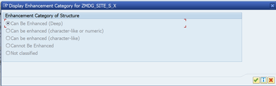

4. **Enhancement Category:** Can be Enhanced (Deep)
5. **Save** and **Activate**

---

## 1.4 Create Table Types

### A. Table Type ZMDG_SITE_T

**Purpose:** Table type for Site data

1. Transaction: **SE11**
2. Select **Data Type** → **Table Type**
3. Name: `ZMDG_SITE_T`
4. Click **Create**

**Configuration:**

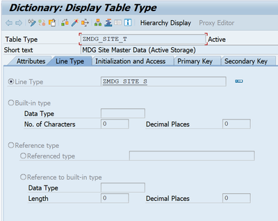

- **Line Type:** ZMDG_SITE_S

**Access Settings:**

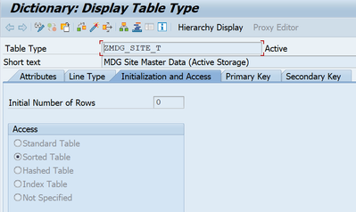

- **Access:** Sorted Table

**Primary Key:**

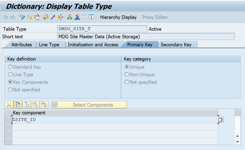

- **Key Category:** Unique
- **Key Component:** ZSITE_ID

5. **Save** and **Activate**

---

### B. Table Type ZMDG_SITE_T_X

**Purpose:** Table type for change indicators

1. Transaction: **SE11**
2. Name: `ZMDG_SITE_T_X`
3. Click **Create**

**Configuration:**

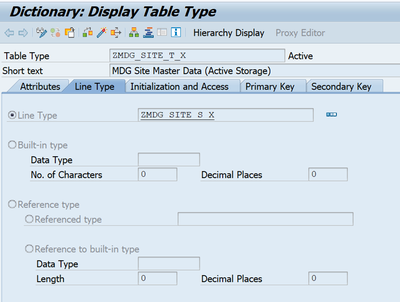

- **Line Type:** ZMDG_SITE_S_X

**Access Settings:**

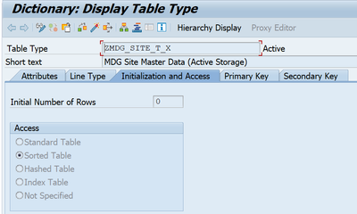

- **Access:** Sorted Table

**Primary Key:**

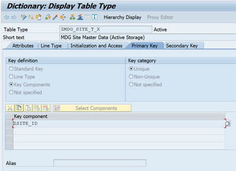

- **Key Category:** Unique
- **Key Component:** ZSITE_ID

4. **Save** and **Activate**

---

## 1.5 Create Lock Object EZMDG_SITE

**Purpose:** Ensure data consistency during concurrent access

1. Transaction: **SE11**
2. Select **Lock Object**
3. Name: `EZMDG_SITE`
4. Click **Create**

**Configuration:**

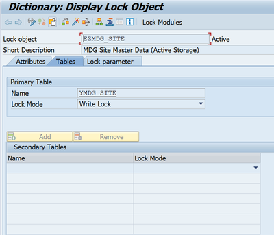

- **Primary Table Name:** YMDG_SITE
- **Lock Mode:** Write Lock (E - Exclusive)

**Lock Parameters:**

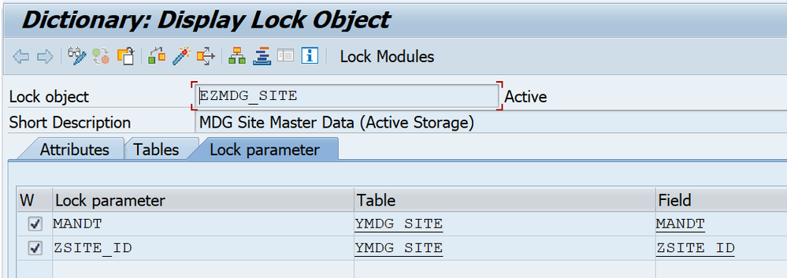

| Parameter Name | Type |
|----------------|------|
| MANDT | Client |
| ZSITE_ID | Site ID |

5. **Save** and **Activate**

**Note:** This generates two function modules automatically:
- `ENQUEUE_EZMDG_SITE` (for locking)
- `DEQUEUE_EZMDG_SITE` (for unlocking)

---

## ✅ Phase 1 Checklist

Before proceeding to Phase 2, ensure all objects are created and activated:

- [ ] Domain **ZDOM_SITE_ID** created and activated
- [ ] Data Element **ZSITE_ID** created and activated
- [ ] Table **YMDG_SITE** created and activated with all fields
- [ ] Structure **ZMDG_SITE_S** created and activated
- [ ] Structure **ZMDG_SITE_S_X** created and activated
- [ ] Table Type **ZMDG_SITE_T** created and activated
- [ ] Table Type **ZMDG_SITE_T_X** created and activated
- [ ] Lock Object **EZMDG_SITE** created and activated
- [ ] Verify lock FMs exist: ENQUEUE_EZMDG_SITE and DEQUEUE_EZMDG_SITE (check in SE37)

---

## 📊 Objects Summary

| Object Type | Object Name | Purpose | Transaction |
|-------------|-------------|---------|-------------|
| Domain | ZDOM_SITE_ID | Site ID domain | SE11 |
| Data Element | ZSITE_ID | Site ID data element | SE11 |
| Table | YMDG_SITE | Active area storage | SE11 |
| Structure | ZMDG_SITE_S | Main data structure | SE11 |
| Structure | ZMDG_SITE_S_X | Change indicator structure | SE11 |
| Table Type | ZMDG_SITE_T | Table type for data | SE11 |
| Table Type | ZMDG_SITE_T_X | Table type for changes | SE11 |
| Lock Object | EZMDG_SITE | Locking mechanism | SE11 |

---

## 💡 Best Practices

- ✅ Use consistent naming conventions (Z/Y prefix for custom objects)
- ✅ Always assign enhancement category for future extensibility
- ✅ Document your objects in transport requests
- ✅ Test lock object by checking generated function modules (SE37)
- ✅ Maintain proper field labels for better usability
- ✅ Use appropriate data classes in technical settings

---

## 🔜 Next Step

Proceed to [Phase 2: Access Class Implementation](02-access-class.md)

---

**📌 Note:** All screenshots are based on actual implementation. Your screen may vary slightly based on SAP version, but the steps remain the same.
