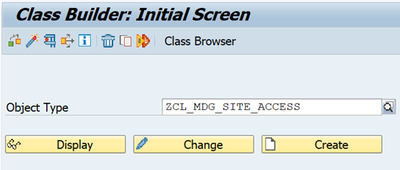
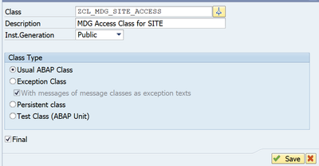
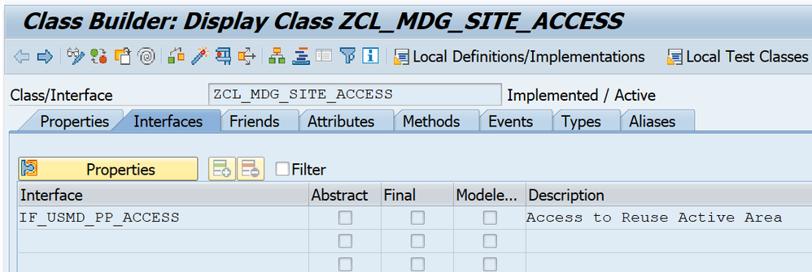
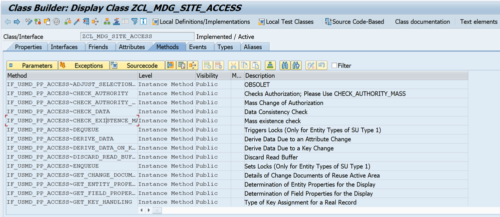

# Phase 2: Access Class Implementation

## Overview

The Access Class is the core component that handles all data operations between MDG and the custom ERP table `YMDG_SITE`. It implements the interface `IF_USMD_PP_ACCESS` which provides methods for reading, writing, locking, and querying data.

**Class Name:** `ZCL_MDG_SITE_ACCESS`

---

## 2.1 Create Access Class

### Step 1: Create Class

1. Open transaction **SE24**
2. Enter class name: `ZCL_MDG_SITE_ACCESS`
3. Click **Create**



---

### Step 2: Provide Class Details



**Configuration:**
- **Description:** MDG Site Access Class
- **Instantiation:** Public
- **Class Type:** Usual ABAP Class

4. Click **Save** (assign to package or local object)

---

### Step 3: Add Interface

1. Navigate to **Interfaces** tab
2. Click **Add Interface** button
3. Enter interface name: `IF_USMD_PP_ACCESS`



4. Press **Enter** to confirm

---

### Step 4: Review Methods

1. Navigate to **Methods** tab
2. You should see all interface methods listed:



**Methods to Implement:**
- `CHECK_EXISTENCE_MASS` - Check if records exist in active area
- `DEQUEUE` - Unlock records
- `ENQUEUE` - Lock records
- `GET_KEY_HANDLING` - Define key handling strategy
- `GET_QUERY_PROPERTIES` - Define searchable fields
- `QUERY` - Search functionality
- `READ_VALUE` - Read data from active area
- `SAVE` - Persist data to YMDG_SITE table

**Note:** Based on your business requirement, you can implement the necessary methods. For this implementation, we'll implement all core methods.

---

## 2.2 Implement Methods

### Method 1: CHECK_EXISTENCE_MASS

**Purpose:** Check if Site IDs already exist in the YMDG_SITE table

Click on method `IF_USMD_PP_ACCESS~CHECK_EXISTENCE_MASS` and add this code:

```abap
METHOD if_usmd_pp_access~check_existence_mass.

  TYPES: BEGIN OF ty_key,
           zsite_id TYPE zsite_id,
         END OF ty_key.

  DATA: lt_key_check TYPE STANDARD TABLE OF ty_key,
        lt_key_db    TYPE STANDARD TABLE OF ty_key,
        ls_key       TYPE ty_key.

  FIELD-SYMBOLS: <ls_input_key> TYPE any,
                 <lv_site_id>   TYPE any.

  CLEAR: et_key,
         et_message,
         ev_not_supported.

  ev_not_supported = abap_false.

  " Only handle SITE entity
  IF iv_entity <> 'SITE'.
    ev_not_supported = abap_true.
    RETURN.
  ENDIF.

  IF it_key IS INITIAL.
    RETURN.
  ENDIF.

  " Extract Site IDs from input
  LOOP AT it_key ASSIGNING <ls_input_key>.
    ASSIGN COMPONENT 'ZSITE_ID' OF STRUCTURE <ls_input_key> TO <lv_site_id>.
    IF sy-subrc = 0.
      ls_key-zsite_id = <lv_site_id>.
      APPEND ls_key TO lt_key_check.
    ENDIF.
  ENDLOOP.

  " Check existence in YMDG_SITE table
  IF lt_key_check IS NOT INITIAL.
    SELECT zsite_id
      FROM ymdg_site
      INTO TABLE lt_key_db
      FOR ALL ENTRIES IN lt_key_check
      WHERE zsite_id = lt_key_check-zsite_id.
  ENDIF.

  " Return existing keys
  LOOP AT it_key ASSIGNING <ls_input_key>.
    ASSIGN COMPONENT 'ZSITE_ID' OF STRUCTURE <ls_input_key> TO <lv_site_id>.
    IF sy-subrc = 0.
      ls_key-zsite_id = <lv_site_id>.
      READ TABLE lt_key_db TRANSPORTING NO FIELDS
        WITH KEY zsite_id = ls_key-zsite_id.
      IF sy-subrc = 0.
        INSERT <ls_input_key> INTO TABLE et_key.
      ENDIF.
    ENDIF.
  ENDLOOP.

ENDMETHOD.

Method 2: DEQUEUE
Purpose: Unlock Site records after processing
```abap
 METHOD if_usmd_pp_access~dequeue.

    FIELD-SYMBOLS: <ls_value>   TYPE any,
                   <lv_site_id> TYPE any.

    IF i_entity <> 'SITE'.
      RETURN.
    ENDIF.

    IF it_value IS INITIAL.
      CALL FUNCTION 'DEQUEUE_EZMDG_SITE'
        EXPORTING
          mode_ymdg_site = i_lock_type
          mandt          = sy-mandt
          _scope         = i_scope.
      RETURN.
    ENDIF.

    LOOP AT it_value ASSIGNING <ls_value>.

      ASSIGN COMPONENT 'ZSITE_ID' OF STRUCTURE <ls_value> TO <lv_site_id>.
      IF sy-subrc <> 0.
        CONTINUE.
      ENDIF.

      CALL FUNCTION 'DEQUEUE_EZMDG_SITE'
        EXPORTING
          mode_ymdg_site = i_lock_type
          mandt          = sy-mandt
          zsite_id       = <lv_site_id>
          _scope         = i_scope.

    ENDLOOP.

  ENDMETHOD.
Method 3: ENQUEUE
Purpose: Lock Site records to prevent concurrent modifications
```abap
METHOD if_usmd_pp_access~enqueue.

    DATA: ls_message TYPE usmd_s_message.

    FIELD-SYMBOLS: <ls_value>   TYPE any,
                   <lv_site_id> TYPE any.

    CLEAR et_message.

    IF i_entity <> 'SITE'.
      RETURN.
    ENDIF.

    IF it_value IS INITIAL.
      CALL FUNCTION 'ENQUEUE_EZMDG_SITE'
        EXPORTING
          mode_ymdg_site = i_lock_type
          mandt          = sy-mandt
          _scope         = i_scope
        EXCEPTIONS
          foreign_lock   = 1
          system_failure = 2
          OTHERS         = 3.

      IF sy-subrc <> 0.
        ls_message-msgid = sy-msgid.
        ls_message-msgno = sy-msgno.
        ls_message-msgty = 'E'.
        ls_message-msgv1 = sy-msgv1.
        ls_message-msgv2 = sy-msgv2.
        ls_message-msgv3 = sy-msgv3.
        ls_message-msgv4 = sy-msgv4.
        APPEND ls_message TO et_message.
      ENDIF.
      RETURN.
    ENDIF.

    LOOP AT it_value ASSIGNING <ls_value>.

      ASSIGN COMPONENT 'ZSITE_ID' OF STRUCTURE <ls_value> TO <lv_site_id>.
      IF sy-subrc <> 0.
        CONTINUE.
      ENDIF.

      CALL FUNCTION 'ENQUEUE_EZMDG_SITE'
        EXPORTING
          mode_ymdg_site = i_lock_type
          mandt          = sy-mandt
          zsite_id       = <lv_site_id>
          _scope         = i_scope
        EXCEPTIONS
          foreign_lock   = 1
          system_failure = 2
          OTHERS         = 3.

      IF sy-subrc <> 0.
        CLEAR ls_message.
        ls_message-msgid = sy-msgid.
        ls_message-msgno = sy-msgno.
        ls_message-msgty = 'E'.
        ls_message-msgv1 = <lv_site_id>.
        ls_message-msgv2 = sy-msgv2.
        ls_message-msgv3 = sy-msgv3.
        ls_message-msgv4 = sy-msgv4.
        APPEND ls_message TO et_message.
      ENDIF.

    ENDLOOP.

  ENDMETHOD.

Method 4: GET_KEY_HANDLING
Purpose: Define that Site IDs are externally managed (not generated by MDG)
```abap
METHOD if_usmd_pp_access~get_key_handling.

    e_key_handling = if_usmd_pp_access=>cs_key_handling-external.

ENDMETHOD.

Method 5: GET_QUERY_PROPERTIES
Purpose: Define which fields are searchable in MDG search screens
```abap
 METHOD if_usmd_pp_access~get_query_properties.

    DATA: ls_search_attr TYPE usmd_s_search_criteria.

    CLEAR: et_search_attributes,
           et_search_attribute_props.

    IF i_entity <> 'SITE'.
      RETURN.
    ENDIF.

    CLEAR ls_search_attr.
    ls_search_attr-fieldname = 'SITE'.
    APPEND ls_search_attr TO et_search_attributes.

    CLEAR ls_search_attr.
    ls_search_attr-fieldname = 'NAME'.
    APPEND ls_search_attr TO et_search_attributes.

    CLEAR ls_search_attr.
    ls_search_attr-fieldname = 'CITY'.
    APPEND ls_search_attr TO et_search_attributes.

    CLEAR ls_search_attr.
    ls_search_attr-fieldname = 'COUNTRY'.
    APPEND ls_search_attr TO et_search_attributes.

    CLEAR ls_search_attr.
    ls_search_attr-fieldname = 'STREET'.
    APPEND ls_search_attr TO et_search_attributes.

    CLEAR ls_search_attr.
    ls_search_attr-fieldname = 'ZIP'.
    APPEND ls_search_attr TO et_search_attributes.

    CLEAR ls_search_attr.
    ls_search_attr-fieldname = 'DESCR'.
    APPEND ls_search_attr TO et_search_attributes.

  ENDMETHOD.

Method 6: QUERY
Purpose: Search functionality for Site records in search screens
```abap
 METHOD if_usmd_pp_access~query.

    DATA: lt_ymdg_site  TYPE STANDARD TABLE OF ymdg_site,
          ls_ymdg_site  TYPE ymdg_site,
          lt_where      TYPE TABLE OF string,
          lt_field_cond TYPE TABLE OF string,
          lv_where      TYPE string,
          lv_field      TYPE string,
          lv_low        TYPE string,
          lv_high       TYPE string,
          lv_field_expr TYPE string,
          lr_data       TYPE REF TO data.

    FIELD-SYMBOLS: <ls_sel>    TYPE usmd_s_sel,
                   <ls_data>   TYPE any,
                   <lv_target> TYPE any,
                   <lv_cond>   TYPE string.

    CLEAR: et_message,
           ef_not_supported.

    IF i_entity <> 'SITE'.
      ef_not_supported = abap_true.
      RETURN.
    ENDIF.

    CREATE DATA lr_data LIKE LINE OF et_data.
    ASSIGN lr_data->* TO <ls_data>.

    LOOP AT it_sel ASSIGNING <ls_sel>.

      IF <ls_sel>-low IS INITIAL AND <ls_sel>-high IS INITIAL.
        CONTINUE.
      ENDIF.

      CASE <ls_sel>-fieldname.
        WHEN 'SITE'.    lv_field = 'ZSITE_ID'.
        WHEN 'NAME'.    lv_field = 'AD_NAME1'.
        WHEN 'CITY'.    lv_field = 'AD_CITY1'.
        WHEN 'COUNTRY'. lv_field = 'LAND1'.
        WHEN 'STREET'.  lv_field = 'AD_STREET'.
        WHEN 'ZIP'.     lv_field = 'AD_PSTCD1'.
        WHEN 'DESCR'.   lv_field = 'AD_REMARK1'.
        WHEN OTHERS.    CONTINUE.
      ENDCASE.

      lv_low  = <ls_sel>-low.
      lv_high = <ls_sel>-high.

      CLEAR lv_where.
      CASE <ls_sel>-option.
        WHEN 'EQ' OR ''.
          IF lv_low CA '*'.
            REPLACE ALL OCCURRENCES OF '*' IN lv_low WITH '%'.
            CONCATENATE lv_field ` LIKE '` lv_low `'` INTO lv_where.
          ELSE.
            CONCATENATE lv_field ` = '` lv_low `'` INTO lv_where.
          ENDIF.
        WHEN 'BT'.
          CONCATENATE lv_field ` BETWEEN '` lv_low `' AND '` lv_high `'`
                      INTO lv_where.
        WHEN 'CP'.
          REPLACE ALL OCCURRENCES OF '*' IN lv_low WITH '%'.
          CONCATENATE lv_field ` LIKE '` lv_low `'` INTO lv_where.
        WHEN 'NE'.
          CONCATENATE lv_field ` <> '` lv_low `'` INTO lv_where.
        WHEN 'GT'.
          CONCATENATE lv_field ` > '` lv_low `'` INTO lv_where.
        WHEN 'LT'.
          CONCATENATE lv_field ` < '` lv_low `'` INTO lv_where.
        WHEN 'GE'.
          CONCATENATE lv_field ` >= '` lv_low `'` INTO lv_where.
        WHEN 'LE'.
          CONCATENATE lv_field ` <= '` lv_low `'` INTO lv_where.
        WHEN OTHERS.
          CONCATENATE lv_field ` = '` lv_low `'` INTO lv_where.
      ENDCASE.

      IF lv_where IS NOT INITIAL.
        APPEND lv_where TO lt_field_cond.
      ENDIF.

    ENDLOOP.

    CLEAR lv_field_expr.
    LOOP AT lt_field_cond ASSIGNING <lv_cond>.
      IF lv_field_expr IS INITIAL.
        lv_field_expr = <lv_cond>.
      ELSE.
        CONCATENATE lv_field_expr ` OR ` <lv_cond> INTO lv_field_expr.
      ENDIF.
    ENDLOOP.

    IF lv_field_expr IS NOT INITIAL.
      CONCATENATE `(` lv_field_expr `)` INTO lv_field_expr.
      APPEND lv_field_expr TO lt_where.
    ENDIF.

    IF i_num_entries > 0.
      IF lt_where IS INITIAL.
        SELECT * FROM ymdg_site INTO TABLE lt_ymdg_site
          UP TO i_num_entries ROWS.
      ELSE.
        SELECT * FROM ymdg_site INTO TABLE lt_ymdg_site
          UP TO i_num_entries ROWS
          WHERE (lt_where).
      ENDIF.
    ELSE.
      IF lt_where IS INITIAL.
        SELECT * FROM ymdg_site INTO TABLE lt_ymdg_site.
      ELSE.
        SELECT * FROM ymdg_site INTO TABLE lt_ymdg_site
          WHERE (lt_where).
      ENDIF.
    ENDIF.

    LOOP AT lt_ymdg_site INTO ls_ymdg_site.

      CLEAR <ls_data>.

      ASSIGN COMPONENT 'SITE' OF STRUCTURE <ls_data> TO <lv_target>.
      IF sy-subrc = 0. <lv_target> = ls_ymdg_site-zsite_id. ENDIF.

      ASSIGN COMPONENT 'NAME' OF STRUCTURE <ls_data> TO <lv_target>.
      IF sy-subrc = 0. <lv_target> = ls_ymdg_site-ad_name1. ENDIF.

      ASSIGN COMPONENT 'CITY' OF STRUCTURE <ls_data> TO <lv_target>.
      IF sy-subrc = 0. <lv_target> = ls_ymdg_site-ad_city1. ENDIF.

      ASSIGN COMPONENT 'COUNTRY' OF STRUCTURE <ls_data> TO <lv_target>.
      IF sy-subrc = 0. <lv_target> = ls_ymdg_site-land1. ENDIF.

      ASSIGN COMPONENT 'STREET' OF STRUCTURE <ls_data> TO <lv_target>.
      IF sy-subrc = 0. <lv_target> = ls_ymdg_site-ad_street. ENDIF.

      ASSIGN COMPONENT 'ZIP' OF STRUCTURE <ls_data> TO <lv_target>.
      IF sy-subrc = 0. <lv_target> = ls_ymdg_site-ad_pstcd1. ENDIF.

      ASSIGN COMPONENT 'DESCR' OF STRUCTURE <ls_data> TO <lv_target>.
      IF sy-subrc = 0. <lv_target> = ls_ymdg_site-ad_remark1. ENDIF.

      INSERT <ls_data> INTO TABLE et_data.

    ENDLOOP.

  ENDMETHOD.
  
Method 7: READ_VALUE
Purpose: Read Site data from YMDG_SITE table for display and editing
```abap
 METHOD if_usmd_pp_access~read_value.

    DATA: lt_ymdg_site  TYPE STANDARD TABLE OF ymdg_site,
          ls_ymdg_site  TYPE ymdg_site,
          lt_where      TYPE TABLE OF string,
          lt_field_cond TYPE TABLE OF string,
          lv_where      TYPE string,
          lv_field      TYPE string,
          lv_low        TYPE string,
          lv_high       TYPE string,
          lv_field_expr TYPE string,
          lr_data       TYPE REF TO data.

    FIELD-SYMBOLS: <ls_sel>    TYPE usmd_s_sel,
                   <ls_data>   TYPE any,
                   <lv_target> TYPE any,
                   <lv_cond>   TYPE string.

    CLEAR et_message.

    IF i_entity <> 'SITE'.
      RETURN.
    ENDIF.

    CREATE DATA lr_data LIKE LINE OF et_data.
    ASSIGN lr_data->* TO <ls_data>.

    LOOP AT it_sel ASSIGNING <ls_sel>.

      CASE <ls_sel>-fieldname.
        WHEN 'SITE'.    lv_field = 'ZSITE_ID'.
        WHEN 'NAME'.    lv_field = 'AD_NAME1'.
        WHEN 'CITY'.    lv_field = 'AD_CITY1'.
        WHEN 'COUNTRY'. lv_field = 'LAND1'.
        WHEN 'STREET'.  lv_field = 'AD_STREET'.
        WHEN 'ZIP'.     lv_field = 'AD_PSTCD1'.
        WHEN 'DESCR'.   lv_field = 'AD_REMARK1'.
        WHEN OTHERS.    CONTINUE.
      ENDCASE.

      lv_low  = <ls_sel>-low.
      lv_high = <ls_sel>-high.

      CLEAR lv_where.
      CASE <ls_sel>-option.
        WHEN 'EQ' OR ''.
          IF lv_low CA '*'.
            REPLACE ALL OCCURRENCES OF '*' IN lv_low WITH '%'.
            CONCATENATE lv_field ` LIKE '` lv_low `'` INTO lv_where.
          ELSE.
            CONCATENATE lv_field ` = '` lv_low `'` INTO lv_where.
          ENDIF.
        WHEN 'BT'.
          CONCATENATE lv_field ` BETWEEN '` lv_low `' AND '` lv_high `'`
                      INTO lv_where.
        WHEN 'CP'.
          REPLACE ALL OCCURRENCES OF '*' IN lv_low WITH '%'.
          CONCATENATE lv_field ` LIKE '` lv_low `'` INTO lv_where.
        WHEN 'NE'.
          CONCATENATE lv_field ` <> '` lv_low `'` INTO lv_where.
        WHEN 'GT'.
          CONCATENATE lv_field ` > '` lv_low `'` INTO lv_where.
        WHEN 'LT'.
          CONCATENATE lv_field ` < '` lv_low `'` INTO lv_where.
        WHEN 'GE'.
          CONCATENATE lv_field ` >= '` lv_low `'` INTO lv_where.
        WHEN 'LE'.
          CONCATENATE lv_field ` <= '` lv_low `'` INTO lv_where.
        WHEN OTHERS.
          CONCATENATE lv_field ` = '` lv_low `'` INTO lv_where.
      ENDCASE.

      IF lv_where IS NOT INITIAL.
        APPEND lv_where TO lt_field_cond.
      ENDIF.

    ENDLOOP.

    CLEAR lv_field_expr.
    LOOP AT lt_field_cond ASSIGNING <lv_cond>.
      IF lv_field_expr IS INITIAL.
        lv_field_expr = <lv_cond>.
      ELSE.
        CONCATENATE lv_field_expr ` OR ` <lv_cond> INTO lv_field_expr.
      ENDIF.
    ENDLOOP.

    IF lv_field_expr IS NOT INITIAL.
      CONCATENATE `(` lv_field_expr `)` INTO lv_field_expr.
      APPEND lv_field_expr TO lt_where.
    ENDIF.

    IF lt_where IS INITIAL.
      SELECT * FROM ymdg_site INTO TABLE lt_ymdg_site.
    ELSE.
      SELECT * FROM ymdg_site INTO TABLE lt_ymdg_site
        WHERE (lt_where).
    ENDIF.

    LOOP AT lt_ymdg_site INTO ls_ymdg_site.

      CLEAR <ls_data>.

      ASSIGN COMPONENT 'SITE' OF STRUCTURE <ls_data> TO <lv_target>.
      IF sy-subrc = 0. <lv_target> = ls_ymdg_site-zsite_id. ENDIF.

      ASSIGN COMPONENT 'NAME' OF STRUCTURE <ls_data> TO <lv_target>.
      IF sy-subrc = 0. <lv_target> = ls_ymdg_site-ad_name1. ENDIF.

      ASSIGN COMPONENT 'CITY' OF STRUCTURE <ls_data> TO <lv_target>.
      IF sy-subrc = 0. <lv_target> = ls_ymdg_site-ad_city1. ENDIF.

      ASSIGN COMPONENT 'COUNTRY' OF STRUCTURE <ls_data> TO <lv_target>.
      IF sy-subrc = 0. <lv_target> = ls_ymdg_site-land1. ENDIF.

      ASSIGN COMPONENT 'STREET' OF STRUCTURE <ls_data> TO <lv_target>.
      IF sy-subrc = 0. <lv_target> = ls_ymdg_site-ad_street. ENDIF.

      ASSIGN COMPONENT 'ZIP' OF STRUCTURE <ls_data> TO <lv_target>.
      IF sy-subrc = 0. <lv_target> = ls_ymdg_site-ad_pstcd1. ENDIF.

      ASSIGN COMPONENT 'DESCR' OF STRUCTURE <ls_data> TO <lv_target>.
      IF sy-subrc = 0. <lv_target> = ls_ymdg_site-ad_remark1. ENDIF.

      INSERT <ls_data> INTO TABLE et_data.

    ENDLOOP.

  ENDMETHOD.
  
Method 8: SAVE
Purpose: Persist approved data to YMDG_SITE table (INSERT, UPDATE, DELETE)
```abap
METHOD if_usmd_pp_access~save.

    DATA: lr_data_ins  TYPE REF TO data,
          lr_data_upd  TYPE REF TO data,
          lr_data_del  TYPE REF TO data,
          lr_data_mod  TYPE REF TO data,
          ls_ymdg_site TYPE ymdg_site,
          ls_message   TYPE usmd_s_message,
          lv_zsite_id  TYPE zsite_id,
          lv_kind      TYPE c LENGTH 1,
          lt_upsert    TYPE STANDARD TABLE OF REF TO data.

    FIELD-SYMBOLS: <l_data>    TYPE any,
                   <lt_data>   TYPE ANY TABLE,
                   <ls_data>   TYPE any,
                   <lv_value>  TYPE any,
                   <lr_ptr>    TYPE REF TO data.

    CLEAR: et_message,
           et_tmp_key_map.

    TRY.
        CALL METHOD io_delta->read_data
          EXPORTING
            i_entity      = 'SITE'
          IMPORTING
            er_t_data_ins = lr_data_ins
            er_t_data_upd = lr_data_upd
            er_t_data_del = lr_data_del
            er_t_data_mod = lr_data_mod.
      CATCH cx_root.
        RETURN.
    ENDTRY.

    IF lr_data_ins IS BOUND.
      APPEND lr_data_ins TO lt_upsert.
    ENDIF.
    IF lr_data_mod IS BOUND.
      APPEND lr_data_mod TO lt_upsert.
    ENDIF.

    LOOP AT lt_upsert ASSIGNING <lr_ptr>.

      ASSIGN <lr_ptr>->* TO <l_data>.
      IF sy-subrc <> 0.
        CONTINUE.
      ENDIF.

      DESCRIBE FIELD <l_data> TYPE lv_kind.

      IF lv_kind = 'h' OR lv_kind = 'H'.
        ASSIGN <lr_ptr>->* TO <lt_data>.
        IF sy-subrc = 0.
          LOOP AT <lt_data> ASSIGNING <ls_data>.

            CLEAR ls_ymdg_site.
            ls_ymdg_site-mandt = sy-mandt.

            ASSIGN COMPONENT 'SITE' OF STRUCTURE <ls_data> TO <lv_value>.
            IF sy-subrc = 0. ls_ymdg_site-zsite_id = <lv_value>. ENDIF.

            ASSIGN COMPONENT 'NAME' OF STRUCTURE <ls_data> TO <lv_value>.
            IF sy-subrc = 0. ls_ymdg_site-ad_name1 = <lv_value>. ENDIF.

            ASSIGN COMPONENT 'CITY' OF STRUCTURE <ls_data> TO <lv_value>.
            IF sy-subrc = 0. ls_ymdg_site-ad_city1 = <lv_value>. ENDIF.

            ASSIGN COMPONENT 'COUNTRY' OF STRUCTURE <ls_data> TO <lv_value>.
            IF sy-subrc = 0. ls_ymdg_site-land1 = <lv_value>. ENDIF.

            ASSIGN COMPONENT 'STREET' OF STRUCTURE <ls_data> TO <lv_value>.
            IF sy-subrc = 0. ls_ymdg_site-ad_street = <lv_value>. ENDIF.

            ASSIGN COMPONENT 'ZIP' OF STRUCTURE <ls_data> TO <lv_value>.
            IF sy-subrc = 0. ls_ymdg_site-ad_pstcd1 = <lv_value>. ENDIF.

            ASSIGN COMPONENT 'DESCR' OF STRUCTURE <ls_data> TO <lv_value>.
            IF sy-subrc = 0. ls_ymdg_site-ad_remark1 = <lv_value>. ENDIF.

            IF ls_ymdg_site-zsite_id IS NOT INITIAL.
              MODIFY ymdg_site FROM ls_ymdg_site.
              IF sy-subrc <> 0.
                CLEAR ls_message.
                ls_message-msgid = 'USMD'.
                ls_message-msgno = '000'.
                ls_message-msgty = 'E'.
                ls_message-msgv1 = 'Save failed:'.
                ls_message-msgv2 = ls_ymdg_site-zsite_id.
                APPEND ls_message TO et_message.
              ENDIF.
            ENDIF.

          ENDLOOP.
        ENDIF.

      ELSE.
        CLEAR ls_ymdg_site.
        ls_ymdg_site-mandt = sy-mandt.

        ASSIGN COMPONENT 'SITE' OF STRUCTURE <l_data> TO <lv_value>.
        IF sy-subrc = 0. ls_ymdg_site-zsite_id = <lv_value>. ENDIF.

        ASSIGN COMPONENT 'NAME' OF STRUCTURE <l_data> TO <lv_value>.
        IF sy-subrc = 0. ls_ymdg_site-ad_name1 = <lv_value>. ENDIF.

        ASSIGN COMPONENT 'CITY' OF STRUCTURE <l_data> TO <lv_value>.
        IF sy-subrc = 0. ls_ymdg_site-ad_city1 = <lv_value>. ENDIF.

        ASSIGN COMPONENT 'COUNTRY' OF STRUCTURE <l_data> TO <lv_value>.
        IF sy-subrc = 0. ls_ymdg_site-land1 = <lv_value>. ENDIF.

        ASSIGN COMPONENT 'STREET' OF STRUCTURE <l_data> TO <lv_value>.
        IF sy-subrc = 0. ls_ymdg_site-ad_street = <lv_value>. ENDIF.

        ASSIGN COMPONENT 'ZIP' OF STRUCTURE <l_data> TO <lv_value>.
        IF sy-subrc = 0. ls_ymdg_site-ad_pstcd1 = <lv_value>. ENDIF.

        ASSIGN COMPONENT 'DESCR' OF STRUCTURE <l_data> TO <lv_value>.
        IF sy-subrc = 0. ls_ymdg_site-ad_remark1 = <lv_value>. ENDIF.

        IF ls_ymdg_site-zsite_id IS NOT INITIAL.
          MODIFY ymdg_site FROM ls_ymdg_site.
        ENDIF.

      ENDIF.

    ENDLOOP.

    IF lr_data_upd IS BOUND.

      ASSIGN lr_data_upd->* TO <l_data>.
      IF sy-subrc = 0.

        DESCRIBE FIELD <l_data> TYPE lv_kind.

        IF lv_kind = 'h' OR lv_kind = 'H'.
          ASSIGN lr_data_upd->* TO <lt_data>.
          IF sy-subrc = 0.
            LOOP AT <lt_data> ASSIGNING <ls_data>.

              CLEAR ls_ymdg_site.
              ls_ymdg_site-mandt = sy-mandt.

              ASSIGN COMPONENT 'SITE' OF STRUCTURE <ls_data> TO <lv_value>.
              IF sy-subrc = 0. ls_ymdg_site-zsite_id = <lv_value>. ENDIF.

              ASSIGN COMPONENT 'NAME' OF STRUCTURE <ls_data> TO <lv_value>.
              IF sy-subrc = 0. ls_ymdg_site-ad_name1 = <lv_value>. ENDIF.

              ASSIGN COMPONENT 'CITY' OF STRUCTURE <ls_data> TO <lv_value>.
              IF sy-subrc = 0. ls_ymdg_site-ad_city1 = <lv_value>. ENDIF.

              ASSIGN COMPONENT 'COUNTRY' OF STRUCTURE <ls_data> TO <lv_value>.
              IF sy-subrc = 0. ls_ymdg_site-land1 = <lv_value>. ENDIF.

              ASSIGN COMPONENT 'STREET' OF STRUCTURE <ls_data> TO <lv_value>.
              IF sy-subrc = 0. ls_ymdg_site-ad_street = <lv_value>. ENDIF.

              ASSIGN COMPONENT 'ZIP' OF STRUCTURE <ls_data> TO <lv_value>.
              IF sy-subrc = 0. ls_ymdg_site-ad_pstcd1 = <lv_value>. ENDIF.

              ASSIGN COMPONENT 'DESCR' OF STRUCTURE <ls_data> TO <lv_value>.
              IF sy-subrc = 0. ls_ymdg_site-ad_remark1 = <lv_value>. ENDIF.

              IF ls_ymdg_site-zsite_id IS NOT INITIAL.
                MODIFY ymdg_site FROM ls_ymdg_site.
              ENDIF.

            ENDLOOP.
          ENDIF.

        ELSE.
          CLEAR ls_ymdg_site.
          ls_ymdg_site-mandt = sy-mandt.

          ASSIGN COMPONENT 'SITE' OF STRUCTURE <l_data> TO <lv_value>.
          IF sy-subrc = 0. ls_ymdg_site-zsite_id = <lv_value>. ENDIF.

          ASSIGN COMPONENT 'NAME' OF STRUCTURE <l_data> TO <lv_value>.
          IF sy-subrc = 0. ls_ymdg_site-ad_name1 = <lv_value>. ENDIF.

          ASSIGN COMPONENT 'CITY' OF STRUCTURE <l_data> TO <lv_value>.
          IF sy-subrc = 0. ls_ymdg_site-ad_city1 = <lv_value>. ENDIF.

          ASSIGN COMPONENT 'COUNTRY' OF STRUCTURE <l_data> TO <lv_value>.
          IF sy-subrc = 0. ls_ymdg_site-land1 = <lv_value>. ENDIF.

          ASSIGN COMPONENT 'STREET' OF STRUCTURE <l_data> TO <lv_value>.
          IF sy-subrc = 0. ls_ymdg_site-ad_street = <lv_value>. ENDIF.

          ASSIGN COMPONENT 'ZIP' OF STRUCTURE <l_data> TO <lv_value>.
          IF sy-subrc = 0. ls_ymdg_site-ad_pstcd1 = <lv_value>. ENDIF.

          ASSIGN COMPONENT 'DESCR' OF STRUCTURE <l_data> TO <lv_value>.
          IF sy-subrc = 0. ls_ymdg_site-ad_remark1 = <lv_value>. ENDIF.

          IF ls_ymdg_site-zsite_id IS NOT INITIAL.
            MODIFY ymdg_site FROM ls_ymdg_site.
          ENDIF.

        ENDIF.

      ENDIF.
    ENDIF.

    IF lr_data_del IS BOUND.

      ASSIGN lr_data_del->* TO <l_data>.
      IF sy-subrc = 0.

        DESCRIBE FIELD <l_data> TYPE lv_kind.

        IF lv_kind = 'h' OR lv_kind = 'H'.
          ASSIGN lr_data_del->* TO <lt_data>.
          IF sy-subrc = 0.
            LOOP AT <lt_data> ASSIGNING <ls_data>.
              CLEAR lv_zsite_id.
              ASSIGN COMPONENT 'SITE' OF STRUCTURE <ls_data> TO <lv_value>.
              IF sy-subrc = 0. lv_zsite_id = <lv_value>. ENDIF.

              IF lv_zsite_id IS NOT INITIAL.
                DELETE FROM ymdg_site WHERE zsite_id = lv_zsite_id.
              ENDIF.
            ENDLOOP.
          ENDIF.
        ELSE.
          CLEAR lv_zsite_id.
          ASSIGN COMPONENT 'SITE' OF STRUCTURE <l_data> TO <lv_value>.
          IF sy-subrc = 0. lv_zsite_id = <lv_value>. ENDIF.

          IF lv_zsite_id IS NOT INITIAL.
            DELETE FROM ymdg_site WHERE zsite_id = lv_zsite_id.
          ENDIF.
        ENDIF.

      ENDIF.
    ENDIF.

  ENDMETHOD.
 
---

## 2.3 Save and Activate

1. Click **Save** button (Ctrl+S)
2. Assign to package or save as local object
3. Click **Activate** button (Ctrl+F3)

---

## ✅ Phase 2 Checklist

- [ ] Class ZCL_MDG_SITE_ACCESS created
- [ ] Interface IF_USMD_PP_ACCESS added
- [ ] All 8 methods implemented
- [ ] Class saved and activated
- [ ] No syntax errors

---

## 📊 Methods Summary

| Method | Purpose | Key Operations |
|--------|---------|----------------|
| CHECK_EXISTENCE_MASS | Check if records exist | SELECT from YMDG_SITE |
| DEQUEUE | Unlock records | DEQUEUE_EZMDG_SITE |
| ENQUEUE | Lock records | ENQUEUE_EZMDG_SITE |
| GET_KEY_HANDLING | Define key strategy | Return external |
| GET_QUERY_PROPERTIES | Define searchable fields | Field list |
| QUERY | Search functionality | Dynamic WHERE, SELECT |
| READ_VALUE | Read data | SELECT and map |
| SAVE | Persist data | INSERT/UPDATE/DELETE |

---

## 💡 Key Points

- **Field Mapping:** MDG field names (SITE, NAME, CITY) map to database fields (ZSITE_ID, AD_NAME1, AD_CITY1)
- **Dynamic WHERE:** QUERY and READ_VALUE build dynamic SQL based on search criteria
- **Lock Management:** Uses auto-generated function modules from EZMDG_SITE
- **Delta Processing:** SAVE method processes inserts, updates, and deletes separately
- **Error Handling:** Messages are returned via et_message parameter

---

## 🔜 Next Step

Proceed to [Phase 3: Data Model Setup with Reuse Area](03-data-model-setup.md)

---

## 📚 Additional Resources

- [IF_USMD_PP_ACCESS Interface Documentation](https://help.sap.com/docs/SAP_MASTER_DATA_GOVERNANCE)
- ABAP Development for MDG

---

**Note:** This is the most critical component of the implementation. Ensure all methods are properly implemented and tested before proceeding to configuration.
