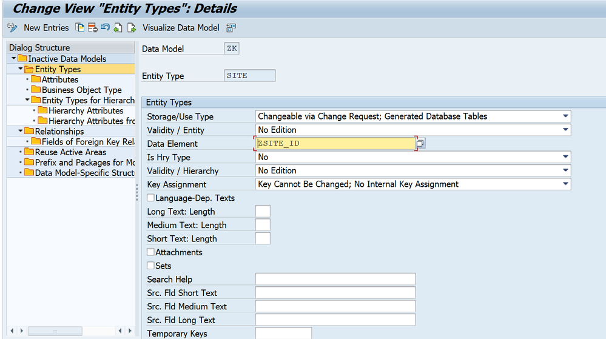
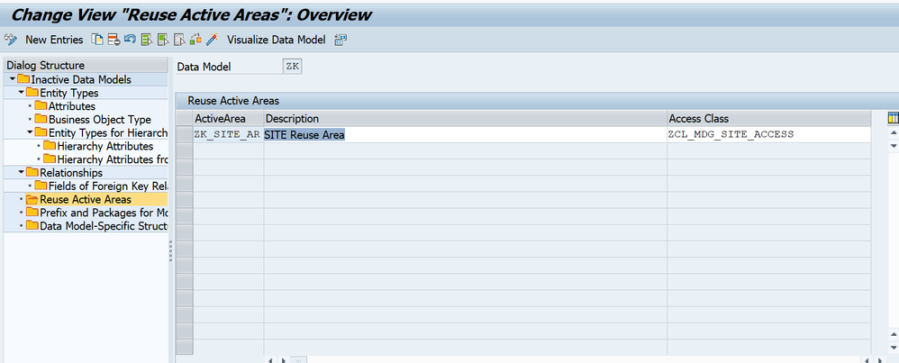
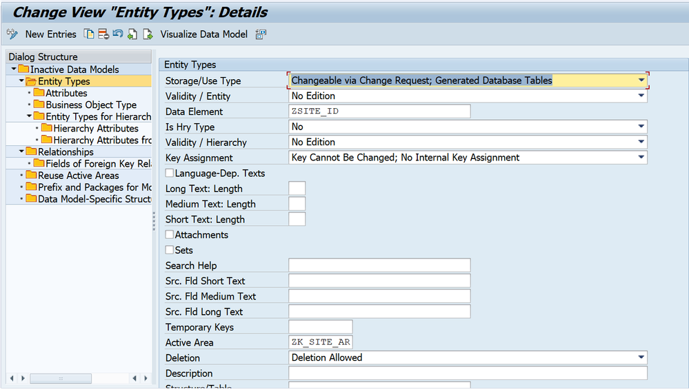

# Phase 3: Data Model Setup with Reuse Area

## Overview

In this phase, we configure the MDG Data Model and create the custom SITE entity. Unlike Flex Mode (which uses generic MDG tables), **Reuse Mode** requires additional configuration to link the custom access class and active area table.

**Key Components:**
- Data Model: **ZK**
- Entity Type: **SITE**
- Reuse Active Area: **ZK_SITE_AR**
- Access Class: **ZCL_MDG_SITE_ACCESS**

---

## 3.1 Reference Implementation Guide

For the basic data model creation steps, you can follow the SAP Community implementation guide:

📚 **[How to Develop a Custom Object with MDG Central Governance](https://www.sap.com/documents/2019/08/94691341-5d7d-0010-87a3-c30de2ffd8ff.html)**

**Important Note:** The referenced guide demonstrates implementation using **Flex Mode**. Since this implementation uses **Reuse Mode**, additional configuration steps are required as described below.

---

## 3.2 Create Data Model

### Step 1: Create Data Model ZK

1. Open transaction **MDGIMG** (MDG IMG)
2. Navigate to: `General Settings → Data Modeling → Define Data Model`
3. Click **New Entries**
4. Create Data Model:
   - **Data Model:** ZK
   - **Description:** Site Master Data Model
   - **Model Type:** Custom
5. **Save**

---

### Step 2: Create Entity Type - SITE

1. In MDGIMG, navigate to: `General Settings → Data Modeling → Define Entity Types`
2. Click **New Entries**
3. Create Entity Type:
   - **Data Model:** ZK
   - **Entity Type:** SITE
   - **Description:** Site Entity
   - **Entity Category:** Main entity

---

### Step 3: Configure Entity Key (Reuse Mode Specific)

**This is where Reuse Mode differs from Flex Mode:**

When creating the SITE entity, assign **ZSITE_ID** as the data element for the entity key.

**Configuration:**
- **Key Field Name:** SITE
- **Data Element:** ZSITE_ID
- **Key Field Type:** Single Key

---

## 3.3 Create Reuse Active Area (Critical for Reuse Mode)

**This step is unique to Reuse Mode and does not exist in Flex Mode.**

### Step 1: Navigate to Active Area Configuration

1. In MDGIMG, navigate to: `General Settings → Data Modeling → Define Active Areas`
2. Click **New Entries**

---

### Step 2: Create Reuse Active Area

Create a Reuse Active Area and assign the custom access class:

**Configuration:**
- **Active Area:** ZK_SITE_AR
- **Description:** Site Reuse Active Area
- **Active Area Type:** Reuse Area (R)
- **Access Class:** ZCL_MDG_SITE_ACCESS

**Important:** The Access Class `ZCL_MDG_SITE_ACCESS` is what connects MDG to your custom table `YMDG_SITE`.

---

## 3.4 Assign Reuse Active Area

You can assign the Reuse Active Area in **two ways**:

### Option 1: At Data Model Level (Recommended)

Assign at the Data Model level if all entities use the same active area.

1. Navigate to: `General Settings → Data Modeling → Define Data Model`
2. Select Data Model **ZK**
3. Assign **ZK_SITE_AR** as default active area

---

### Option 2: At Entity Type Level

Assign at the Entity Type level for entity-specific active areas.

1. Navigate to: `General Settings → Data Modeling → Define Entity Types`
2. Select Entity Type **SITE**
3. In **Active Area Assignment** section:
   - **Active Area:** ZK_SITE_AR
   - **Storage Type:** Reuse Area
4. **Save** your configuration.

---

## 3.5 Activate Data Model

1. In MDGIMG, navigate to: `General Settings → Data Modeling → Activate Data Model`
2. Select Data Model **ZK**
3. Click **Activate**
4. Check activation log for errors

---

## ✅ Phase 3 Checklist

- [ ] Data Model ZK created
- [ ] Entity Type SITE created
- [ ] Entity key ZSITE_ID configured
- [ ] Reuse Active Area ZK_SITE_AR created
- [ ] Access Class ZCL_MDG_SITE_ACCESS assigned to active area
- [ ] Active Area assigned to entity type
- [ ] Entity attributes defined (7 fields)
- [ ] Structures assigned to entity type
- [ ] Data model structures generated successfully
- [ ] Data model activated without errors

---

## 📊 Configuration Summary

| Component | Value | Type |
|-----------|-------|------|
| Data Model | ZK | Custom |
| Entity Type | SITE | Main Entity |
| Active Area | ZK_SITE_AR | Reuse Area |
| Access Class | ZCL_MDG_SITE_ACCESS | Custom Class |
| Active Table | YMDG_SITE | Custom Table |
| Key Field | ZSITE_ID | External Key |

---

## 💡 Reuse Mode vs Flex Mode - Key Differences

| Aspect | Flex Mode | Reuse Mode (This Implementation) |
|--------|-----------|----------------------------------|
| Storage | Generic MDG tables | Custom table (YMDG_SITE) |
| Active Area | Standard | Reuse Active Area (ZK_SITE_AR) |
| Access Class | Not required | Required (ZCL_MDG_SITE_ACCESS) |
| Data Persistence | MDG managed | Custom managed |
| Flexibility | Quick setup | Full control |

---

## 🔜 Next Step

Proceed to [Phase 4: SMT Mappings](04-smt-mappings.md)

---

## ⚠️ Common Issues and Solutions

| Issue | Solution |
|-------|----------|
| Active Area not appearing | Ensure Active Area Type = 'R' (Reuse Area) |
| Access Class error | Verify class is activated and implements IF_USMD_PP_ACCESS |
| Generation fails | Check all structures (ZMDG_SITE_S, etc.) are activated |
| Activation errors | Review entity attributes data elements |

---

**Important:** The Reuse Active Area and Access Class assignment are critical for Reuse Mode. Without these, MDG will not know how to persist data to YMDG_SITE table.
