# Phase 4: SMT Mappings

## Overview

SMT (Staging Model Transformation) mappings are essential for data transformation between the staging area and active area in MDG. In Reuse Mode, these mappings ensure data flows correctly between:
- **Active Area** (YMDG_SITE - Custom Table) ↔ **Staging Area** (MDG Temporary Storage)

**Two mappings are required:**
1. **Z_MAP_SITE_2_STA** - Active Area → Staging Area (for loading data into change requests)
2. **Z_MAP_SITE_2_PP** - Staging Area → Active Area (for saving approved data)

---

## 4.1 Register the Mappings

Before creating the mappings, we need to register them in the data model configuration.

### Step 1: Navigate to Data Model Configuration

1. Open transaction **MDGIMG**
2. Navigate to: `General Settings → Data Modeling → Generate Data Model-Specific Structures`
3. Select data model **ZK**
4. Click **Continue** or **Enter**

---

### Step 2: Open Mapping View

1. In the data model configuration screen, locate and open the **Mapping** view

---

### Step 3: Maintain Mapping Entries

Maintain the following entries for entity **SITE**:

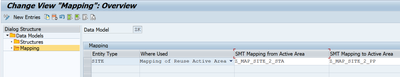

**Configuration:**
- **Entity Type:** SITE
- **SMT Mapping from Active Area:** Z_MAP_SITE_2_STA
- **SMT Mapping to Active Area:** Z_MAP_SITE_2_PP

**Save** your changes.

**Note:** These are the mapping names we will create in the next steps. Registering them here tells MDG which mappings to use for the SITE entity.

---

## 4.2 Create Active Area → Staging Area Mapping

This mapping transforms data from your custom structure (ZMDG_SITE_S) to the MDG staging structure (ZSZK_S_ZK_PP_SITE).

### Step 1: Navigate to Mapping Configuration

1. In MDGIMG, navigate to: `General Settings → Data Modeling → Create and Edit Mappings → Create and Edit Mappings`

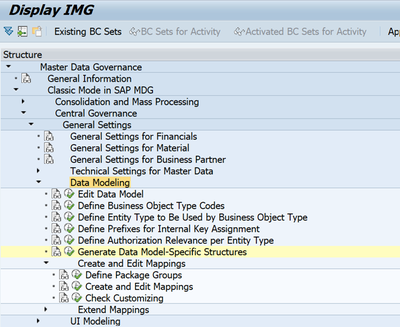

---

### Step 2: Create New Mapping

1. In the mapping editor, navigate to **Mapping → New**
2. Provide the mapping name: **Z_MAP_SITE_2_STA**
3. Assign to a **package** (or save as local object)

---

### Step 3: Create Mapping Step

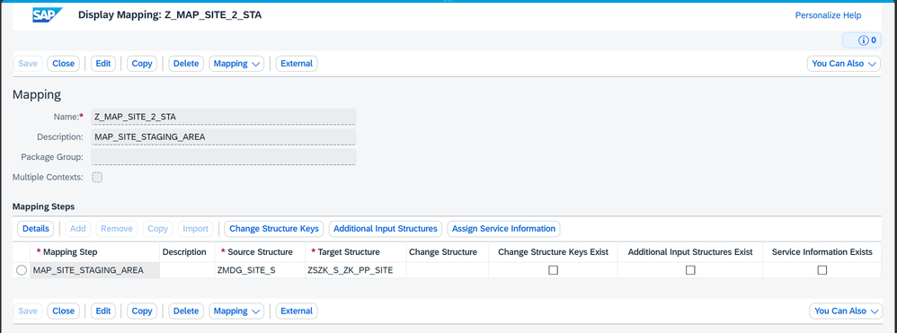

Create the mapping step with the following details:
- **Mapping Step:** MAP_SITE_STAGING_AREA
- **Source Structure:** ZMDG_SITE_S
- **Target Structure:** ZSZK_S_ZK_PP_SITE

Click **Create** or **Enter** to confirm.

---

### Step 4: Define Transformations

1. Select the mapping step **MAP_SITE_STAGING_AREA**
2. Click **Details** button
3. Navigate to the **Transformations** tab
4. Click **Add** or **New Entry** to add a new mapping field

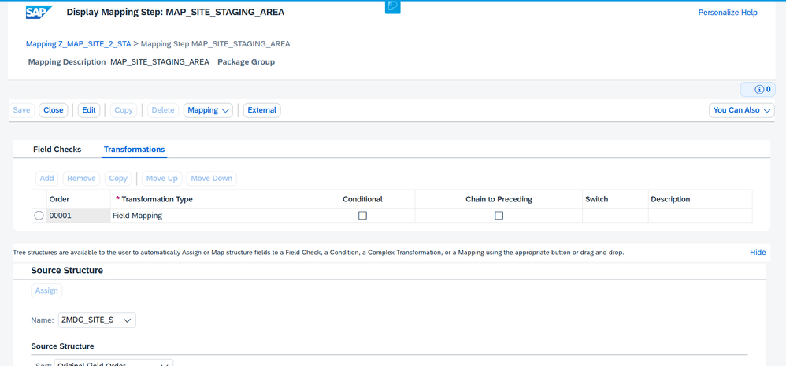

---

### Step 5: Maintain Field Mappings

1. Select transformation order **00001**
2. Maintain the field mappings between source and target structures:

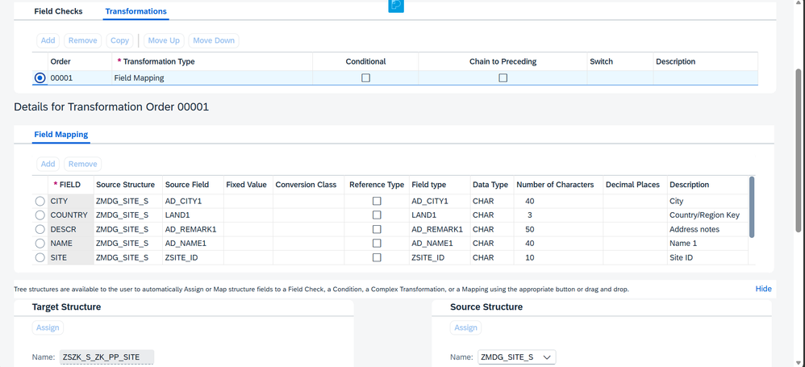

**Field Mapping Configuration:**

| Source Field (ZMDG_SITE_S) | Target Field (ZSZK_S_ZK_PP_SITE) | Transformation |
|----------------------------|----------------------------------|----------------|
| SITE | SITE | Direct (1:1) |
| NAME | NAME | Direct (1:1) |
| CITY | CITY | Direct (1:1) |
| COUNTRY | COUNTRY | Direct (1:1) |
| STREET | STREET | Direct (1:1) |
| ZIP | ZIP | Direct (1:1) |
| DESCR | DESCR | Direct (1:1) |

**Transformation Type:** Direct Assignment (most common for simple mappings)

---

### Step 6: Save the Mapping

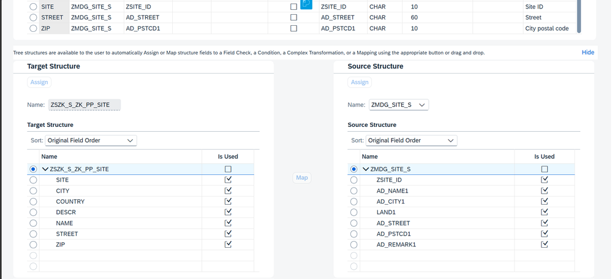

1. Click **Save** button
2. Verify no errors in the status bar
3. **Activate** the mapping if required

---

## 4.3 Create Staging Area → Active Area Mapping

This mapping transforms data from MDG staging structure (ZSZK_S_ZK_PP_SITE) back to your custom structure (ZMDG_SITE_S) for persistence.

### Step 1: Navigate to Mapping Configuration

1. In MDGIMG, navigate to: `General Settings → Data Modeling → Create and Edit Mappings → Create and Edit Mappings`

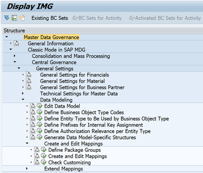

---

### Step 2: Create New Mapping

1. In the mapping editor, navigate to **Mapping → New**
2. Provide the mapping name: **Z_MAP_SITE_2_PP**
3. Assign to a **package** (or save as local object)

---

### Step 3: Create Mapping Step

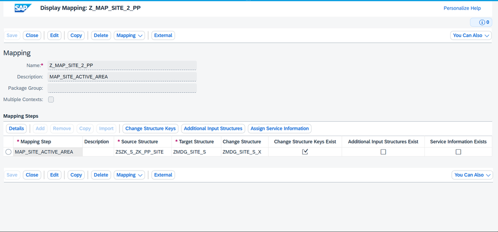

Create the mapping step with the following details:
- **Mapping Step:** MAP_SITE_ACTIVE_AREA
- **Source Structure:** ZSZK_S_ZK_PP_SITE
- **Target Structure:** ZMDG_SITE_S

Click **Create** or **Enter** to confirm.

---

### Step 4: Assign Change Structure Keys (Critical Step)

**This step is unique to the Staging → Active Area mapping.**

1. Select the mapping step **MAP_SITE_ACTIVE_AREA**
2. Click **Change Structure Keys** button
3. Add entry: **ZSITE_ID**

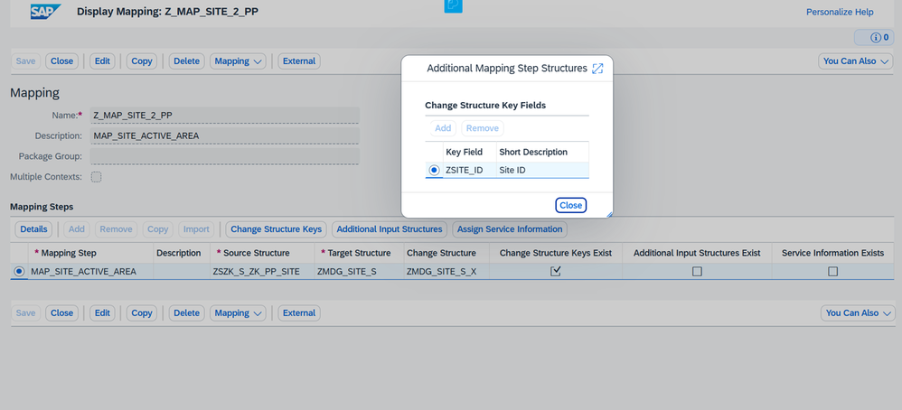

**Purpose:** This tells MDG which field is the key field for identifying records during update operations.

---

### Step 5: Define Transformations

1. Select the mapping step **MAP_SITE_ACTIVE_AREA**
2. Click **Details** button
3. Navigate to the **Transformations** tab
4. Click **Add** or **New Entry** to add a new mapping field

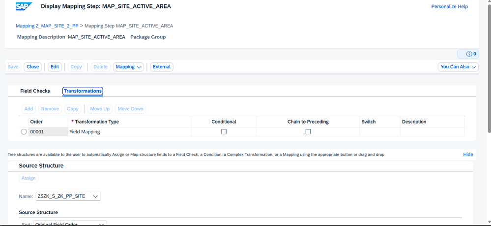

---

### Step 6: Maintain Field Mappings

1. Select transformation order **00001**
2. Maintain the field mappings between source and target structures:

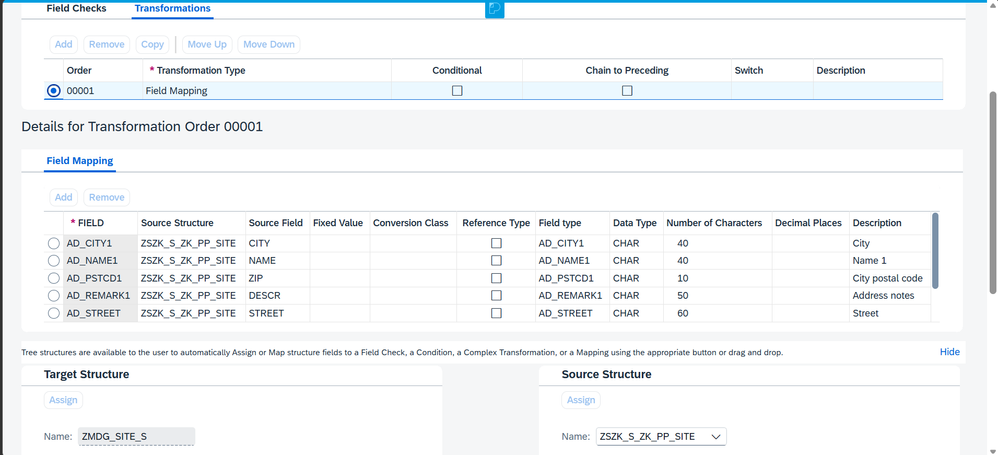

**Field Mapping Configuration:**

| Source Field (ZSZK_S_ZK_PP_SITE) | Target Field (ZMDG_SITE_S) | Transformation |
|----------------------------------|----------------------------|----------------|
| SITE | SITE | Direct (1:1) |
| NAME | NAME | Direct (1:1) |
| CITY | CITY | Direct (1:1) |
| COUNTRY | COUNTRY | Direct (1:1) |
| STREET | STREET | Direct (1:1) |
| ZIP | ZIP | Direct (1:1) |
| DESCR | DESCR | Direct (1:1) |

**Transformation Type:** Direct Assignment

---

### Step 7: Save the Mapping

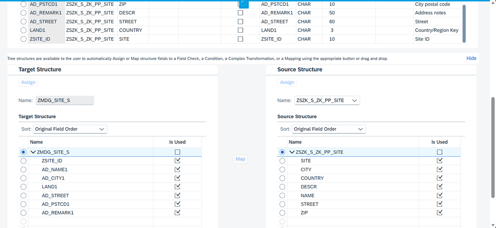

1. Click **Save** button
2. Verify no errors in the status bar
3. **Activate** the mapping if required

---

## ✅ Phase 4 Checklist

- [ ] Mappings registered in data model configuration
- [ ] Z_MAP_SITE_2_STA created (Active → Staging)
- [ ] Mapping step MAP_SITE_STAGING_AREA created
- [ ] Field transformations defined for Active → Staging
- [ ] Z_MAP_SITE_2_STA saved and activated
- [ ] Z_MAP_SITE_2_PP created (Staging → Active)
- [ ] Mapping step MAP_SITE_ACTIVE_AREA created
- [ ] Change structure key ZSITE_ID assigned
- [ ] Field transformations defined for Staging → Active
- [ ] Z_MAP_SITE_2_PP saved and activated

---

## 📊 Mapping Summary

### Mapping 1: Active Area → Staging Area

| Component | Value |
|-----------|-------|
| Mapping Name | Z_MAP_SITE_2_STA |
| Mapping Step | MAP_SITE_STAGING_AREA |
| Source | ZMDG_SITE_S (Custom Structure) |
| Target | ZSZK_S_ZK_PP_SITE (MDG Staging) |
| Purpose | Load data into change requests |

### Mapping 2: Staging Area → Active Area

| Component | Value |
|-----------|-------|
| Mapping Name | Z_MAP_SITE_2_PP |
| Mapping Step | MAP_SITE_ACTIVE_AREA |
| Source | ZSZK_S_ZK_PP_SITE (MDG Staging) |
| Target | ZMDG_SITE_S (Custom Structure) |
| Key Field | ZSITE_ID |
| Purpose | Save approved data to YMDG_SITE |

---

## 💡 Key Points

- **Bidirectional Mapping:** Both mappings are required for complete data flow
- **Change Structure Keys:** Only required for Staging → Active mapping
- **Direct Assignment:** Most common transformation type for 1:1 field mappings
- **Field Names:** Must match exactly between source and target structures
- **Activation:** Some systems require explicit activation of mappings

---

---

## 🔜 Next Step

Proceed to [Phase 5: Workflow, UI & Role Model](05-workflow-ui-roles.md)

---

## ⚠️ Common Issues and Solutions

| Issue | Solution |
|-------|----------|
| Mapping not found during runtime | Verify mapping is registered in section 4.1 |
| Field mapping errors | Ensure field names match exactly (case-sensitive) |
| Change structure key missing | Must be defined for Staging → Active mapping |
| Mapping not activated | Check if system requires explicit activation |
| Transformation errors | Verify data elements are compatible |

---

**Important:** SMT mappings are executed automatically by MDG during change request processing. Errors in mappings will prevent data from being saved to YMDG_SITE table.
