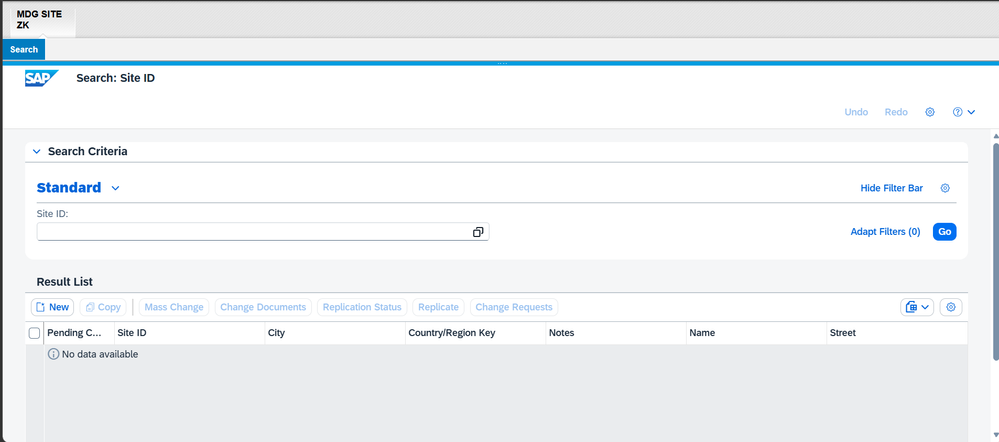
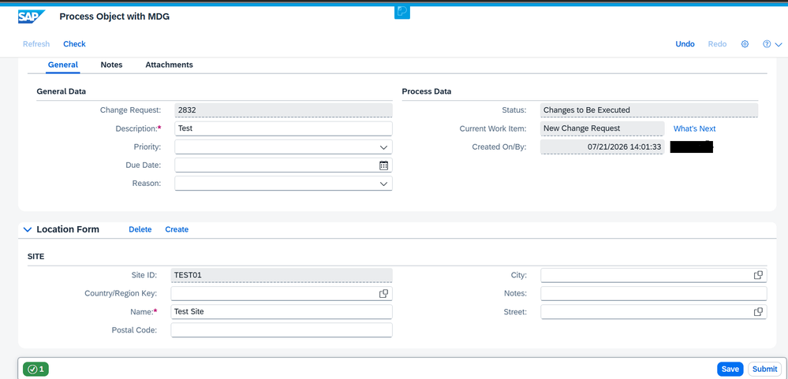
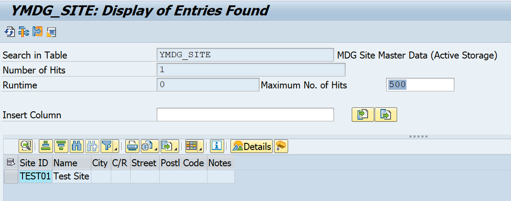
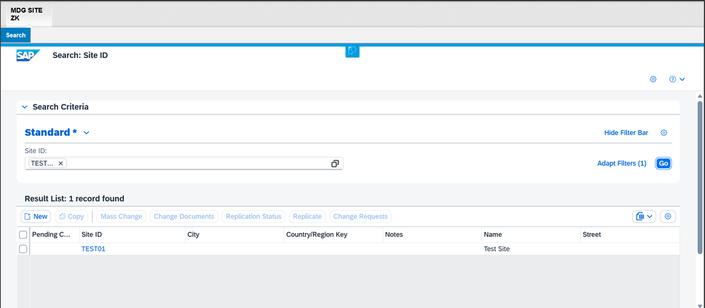

# Phase 8: Testing

## Overview

This final phase validates the complete end-to-end implementation of the custom SITE master data object in MDG Reuse Mode. We will create a Site record, submit it for approval, and verify that the approved data is successfully persisted in the custom ERP table `YMDG_SITE`.

**Testing Scope:**
- Create new Site record through MDG UI
- Submit change request for approval
- Approve the change request
- Verify data persistence in YMDG_SITE table
- Validate data consistency

---

## 8.1 Access MDG Application

### Step 1: Launch NWBC

1. Open **SAP NetWeaver Business Client (NWBC)**
2. Log in with a user assigned to the MDG Site Requester role (created in Phase 7)

---

### Step 2: Open MDG Site Role

1. Navigate to the **MDG Site** role/application
2. You should see the Site master data homepage with options like:
   - Search for Site
   - Create New Site
---

## 8.2 Create New Site Record

### Step 1: Initiate Site Creation

1. Click **New** button to create a new Site record
2. The system will create a new change request

---

### Step 2: Enter Site Details

Enter the required Site details in the form:

**Sample Test Data:**

| Field | Value | Description |
|-------|-------|-------------|
| **Site ID** | SITE001 | Unique Site identifier |
| **Name** | Main Distribution Center | Site name |
| **City** | New York | City |
| **Country** | US | Country code |
| **Street** | 123 Main Street | Street address |
| **ZIP** | 10001 | Postal code |
| **Description** | Primary distribution center for East Coast operations | Site description |

---

### Step 3: Submit Change Request

1. After entering all required data, click **Check** to validate the entries
2. Review any validation messages (if configured)
3. Click **Submit** to submit the change request for approval
4. Note down the **Change Request Number** for tracking
5. The system displays a confirmation message

**Expected Result:** Change request created successfully and routed to approver based on configured workflow (Phase 5).

---

## 8.3 Approve Change Request

### Step 1: Switch to Approver User

1. Log out or open a new session
2. Log in with a user assigned to the MDG Site Approver role

---

### Step 2: Access Worklist

1. Navigate to **My Worklist** or **Inbox**
2. Locate the change request created in Step 8.2
3. Open the change request for review

---

### Step 3: Review and Approve

1. Review the Site details entered by the requester
2. Verify data accuracy
3. Click **Approve** button
4. Add approval comments (optional)
5. Confirm the approval

**Expected Result:** Change request approved and status changes to "Activated" or "Completed".

---

## 8.4 Verify Data in Active Area Table

This is the critical step that validates Reuse Mode implementation - checking if data is persisted in the custom table `YMDG_SITE`.

### Step 1: Open Table Display Transaction

1. Open transaction **SE16N** (or SE16)
2. Enter table name: **YMDG_SITE**
3. Press **Enter** or click **Continue**

---

### Step 2: Display Table Contents

1. Click **Execute** (F8) to display all records
2. You should see the approved Site record in the table

**Verification Points:**
- Record exists in YMDG_SITE table
- All field values are correctly populated
- Data matches what was entered in the change request
---

## 8.5 Verify Data Consistency in MDG

### Step 1: Search for Site in MDG

1. Go back to NWBC MDG application
2. Click **Search** for Site
3. Enter **Site ID:** TEST01
4. Click **Search**

---

### Step 2: Open Site Record

1. Select the Site record from search results
2. Click **Display** to open the Site details

---

### Step 3: Compare Data

**Verification:** Data displayed in MDG should match exactly with data in YMDG_SITE table (verified in Step 8.4).

**Expected Result:** Complete data consistency between MDG frontend and custom active area table.

---

## 8.6 Additional Test Scenarios

### Test Scenario 1: Update Existing Site

1. Search for Site **TEST01**
2. Click **Edit** (create new change request)
3. Modify one or more fields (e.g., change City to "Boston")
4. Submit for approval
5. Approve the change request
6. Verify in SE16N that YMDG_SITE table reflects the updated values

**Expected Result:** Record updated successfully in YMDG_SITE.

---

### Test Scenario 2: Search Functionality

1. In MDG, use **Search** screen
2. Try different search criteria:
   - Search by Site ID
   - Search by Name
   - Search by City
   - Search by Country
3. Verify search results are accurate

**Expected Result:** All search queries work correctly (validates QUERY method in access class).

---

### Test Scenario 3: Lock Management

1. Open Site **SITE001** for editing (User A)
2. Try to open the same Site for editing with another user (User B)
3. System should display a lock message

**Expected Result:** Record locking works correctly (validates ENQUEUE/DEQUEUE methods).

---

### Test Scenario 4: Validation Rules (if configured)

1. Try to create a Site with duplicate Site ID
2. System should reject with appropriate error message

**Expected Result:** Business validations work as configured.

---

## ✅ Phase 8 Test Checklist

### Basic Tests
- [ ] MDG application accessible in NWBC
- [ ] Site role/application opens successfully
- [ ] New Site record can be created
- [ ] All fields are editable and accept data
- [ ] Change request submits successfully
- [ ] Approval workflow executes correctly
- [ ] Data persists in YMDG_SITE table after approval
- [ ] All fields populated correctly in table
- [ ] Data consistency between MDG and table verified

### Advanced Tests
- [ ] Update existing Site record works
- [ ] Search by Site ID works
- [ ] Search by Name works
- [ ] Search by City works
- [ ] Record locking works (concurrent access)
- [ ] Validation rules enforced (if any)
- [ ] Change history tracked correctly
- [ ] Delete functionality works (if enabled)

### Performance Tests
- [ ] Search response time acceptable (< 3 seconds)
- [ ] Record save time acceptable (< 5 seconds)
- [ ] Large data volume handled (100+ records)

---

## 🎯 Success Criteria

The implementation is successful if:

1. ✅ **Data Creation:** New Site records can be created through MDG UI
2. ✅ **Workflow:** Change requests route correctly to approvers
3. ✅ **Data Persistence:** Approved data saves to YMDG_SITE table
4. ✅ **Data Accuracy:** All fields populated correctly with no data loss
5. ✅ **Data Consistency:** MDG display matches table data
6. ✅ **Search:** All search operations return correct results
7. ✅ **Locking:** Concurrent access controlled properly
8. ✅ **Performance:** System responds within acceptable time limits

---

## 📊 Test Results Summary

| Test Case | Description | Expected Result | Actual Result | Status |
|-----------|-------------|-----------------|---------------|--------|
| TC-01 | Create new Site | Record created and saved | | |
| TC-02 | Approve change request | Data persisted to YMDG_SITE | | |
| TC-03 | Data consistency check | MDG = Table data | | |
| TC-04 | Update existing Site | Record updated in table | | |
| TC-05 | Search by Site ID | Correct record returned | | |
| TC-06 | Search by Name | Correct records returned | | |
| TC-07 | Record locking | Lock message displayed | | |
| TC-08 | Delete Site | Record removed from table | | |

**Status Legend:** ✅ Pass | ❌ Fail | ⏸️ Blocked | ⏭️ Skipped

---

## 🐛 Troubleshooting Common Issues

### Issue 1: Data Not Persisting to YMDG_SITE

**Symptoms:** Approval completes but table remains empty

**Possible Causes:**
- SAVE method in ZCL_MDG_SITE_ACCESS has errors
- SMT mapping Z_MAP_SITE_2_PP not configured correctly
- Database commit not executed

**Solution:**
1. Check ST22 for runtime errors
2. Debug SAVE method (set breakpoint)
3. Verify SMT mapping field assignments
4. Check database logs

---

### Issue 2: Search Not Working

**Symptoms:** Search returns no results or errors

**Possible Causes:**
- QUERY or READ_VALUE methods have errors
- Search attributes not configured in GET_QUERY_PROPERTIES
- WHERE clause syntax errors

**Solution:**
1. Check ST22 for runtime errors
2. Debug QUERY method
3. Verify search attributes configuration
4. Test SQL WHERE clause in SE16N

---

### Issue 3: Lock Errors

**Symptoms:** Lock object errors or unable to edit records

**Possible Causes:**
- Lock object EZMDG_SITE not activated
- ENQUEUE/DEQUEUE methods have errors
- Lock not released after previous operation

**Solution:**
1. Verify lock object in SE11
2. Check if lock FMs exist (SE37)
3. Debug ENQUEUE/DEQUEUE methods
4. Manually release locks in SM12

---

### Issue 4: Field Mapping Errors

**Symptoms:** Some fields empty in table or MDG display

**Possible Causes:**
- Field names mismatch in SMT mappings
- Access class field assignments incorrect
- Structure definitions mismatch

**Solution:**
1. Verify SMT mapping field names (case-sensitive)
2. Check SAVE method field assignments
3. Compare structure ZMDG_SITE_S with YMDG_SITE

---

## 🎓 Lessons Learned

Document any issues encountered and solutions applied:

1. **Issue:** [Describe the issue]
   - **Solution:** [How it was resolved]
   - **Prevention:** [How to avoid in future]

2. **Issue:** [Describe the issue]
   - **Solution:** [How it was resolved]
   - **Prevention:** [How to avoid in future]

---

## 🎉 Conclusion

**Congratulations!** If all tests pass, you have successfully implemented a custom master data object in SAP MDG using Reuse Mode with direct persistence to a custom ERP table.

### Key Achievements:

- **Reusable Pattern:** This implementation serves as a template for other custom objects
- **Full Control:** Direct control over data persistence and structure
- **MDG Governance:** Leverages full MDG governance capabilities
- **Production Ready:** Solution ready for deployment after UAT

---

## 📞 Support & Feedback

If you encounter any issues or have questions:
- Check the troubleshooting section above
- Review SAP MDG documentation
- Raise issues in this GitHub repository

---

**🌟 Project Complete! Thank you for following this implementation guide!**
